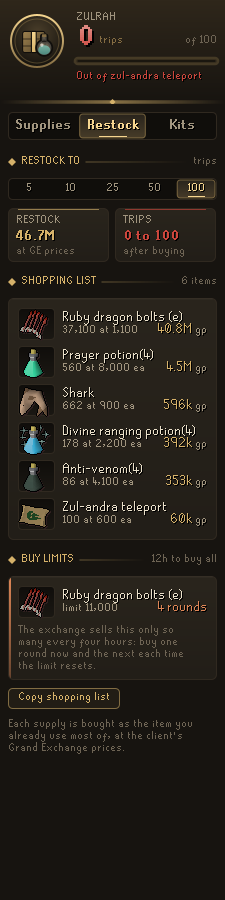
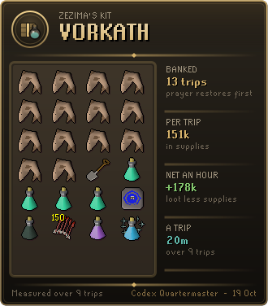
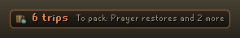

# Codex Quartermaster

**How many trips your bank supports, what runs out first, and what restocking costs.**

Pick what you are doing (Vorkath, Zulrah, a slayer task) or save your own inventory as a kit. Codex Quartermaster counts your bank against it supply by supply. Food counts in hitpoints healed, potions in doses, and ammo one by one. After two trips it stops guessing and plans from what you really used.

Part of the **Codex** suite of RuneLite plugins. They share one look: warm ink, aged gold and the game's own fonts.

<p align="center">
  
  
  
</p>

## What it does

**Supplies.** The big figure is the trips your bank supports for the chosen kit, with what runs out first. Each supply has a row: what you hold, what a trip uses, and how many trips that lasts. Things that come back every trip, such as a spade, are marked *kept* and never count against you. Tiles show what a trip costs, how long the bank lasts at your pace ("4h 20m at 20m a trip"), the loot a trip brings home and what the kit earns an hour.

**Packing check.** At the bank, the Supplies page lists what the chosen kit still needs, with the item to take and how many. While you pack, the bank outlines those items with a count, and each mark goes once that item is packed. Press **Show in bank** and the bank shows only what is left to take, like a bank tag tab. If you leave with a supply forgotten, such as the spade for Barrows, a chat line says so.

<p align="center">
  
  
</p>

**Restock.** Pick a target of 5, 10, 25, 50 or 100 trips and get a shopping list at Grand Exchange prices. Each supply is bought as the item you already use most of, so anglerfish if you eat anglerfish, never cake slices. **Copy shopping list** puts it on the clipboard. When an order is more than the exchange sells in four hours (11,000 enchanted ruby bolts, 2,000 prayer potions), a **Buy limits** card says how many rounds it takes. With two or more kits, **All kits** stocks them all from the one bank they share. Iron accounts get a list of what to make or gather instead of a bill.

<p align="center">
  
  
</p>

**Kits.** Nine presets ship with the plugin: Vorkath, Zulrah, Barrows, General Graardor, Vardorvis, Nex, Theatre of Blood, a slayer task and Wintertodt. Withdraw what you take and press **Save my inventory as a kit** to add your own. When you pack it again, the Quartermaster recognises it and switches to it. Rename a kit, or right-click a supply to set its amount or remove it.

**Learning from your trips.** A trip runs from closing the bank to opening it again. What you set out with and what comes back are compared, supply by supply. Deaths, quick bank shuffles and anything that changes while you are logged out are not counted. After five trips with a kit of your own, **Pack to your trips** suggests amounts that cover nine trips in ten, and how many inventory slots that frees.

**Kit card.** **Copy kit card** copies a picture of the kit to paste into a chat: the inventory a trip packs, the trips your bank holds, what a trip costs and what it earns.

<p align="center">
  
</p>

**Plaque and chat.** A slim plaque in the game view shows the trips left and what runs out first. Mid-pack at the bank, it says what is still to withdraw. When you leave with only a few trips of supplies left, a chat line says which runs out and what restocking costs.

<p align="center">
  
  
</p>

## Settings that matter

- **Plan from your trips** (on): once a kit has two measured trips, plan from what you really used.
- **Recognise packed kits** (on): switch to one of your saved kits when you leave the bank carrying it.
- **Warn at trips left** (3): the chat warning when supplies run low.
- **Packing check** and **Mark what to withdraw** (both on): the help at the bank.
- **Supply plaque** (at the bank): when the plaque shows, or never.
- **Name on cards** (on): turn off to share the kit card without your character's name.

## With other Codex plugins

The Quartermaster works on its own. If [Codex Bank Steward](https://github.com/Nubles/OSRS-Codex-Bank-Steward) saved your bank at a visit the Quartermaster missed (it was just installed, or turned off), that newer bank is counted, and the panel says whose it is until you open your own. Nothing else is read from other plugins.

The Quartermaster saves your kits in a stable shape for others to read. Codex Bank Steward uses it to keep your kits' supplies off its sell list; Codex Guardian and Codex Provisioner read it too.

## How it counts

Supplies that stand in for one another are pooled. Food counts in hitpoints healed, so a shark is 20 and a manta ray 22. Prayer potions, super restores and sanfew serums count as prayer doses, and ranging, divine ranging and bastion potions as ranging doses. Magic, super combat, antifire, anti-venom, stamina and Saradomin brews work the same way. Enchanted ruby and diamond dragon bolts count together. Anything else a saved kit carries counts as its own item, including the runes in a rune pouch.

Your bank is read whenever it is open and remembered as last seen, so the panel works anywhere. Potion storage counts too. What you carry is added: inventory, worn gear, rune pouch and the ammo in Dizana's quiver. Prices are RuneLite's Grand Exchange prices. Everything is saved per account in your RuneLite profile. A save damaged on disk keeps all it can: one unreadable kit or setting is lost alone. Before a damaged save, or one a newer version wrote, is first saved over, a copy of it as found is kept aside in your profile.

Preset amounts are a typical trip of several kills. They are only a starting point until your own trips are measured.

## For plugin authors

Each save writes a documented entry: RS profile config, group `codexquartermaster`, key `kitsV1`, a JSON object:

```json
{
  "version": 1,
  "active": "kit:3",
  "target": 10,
  "kits": [
    {
      "id": "kit:3", "name": "Vorkath", "preset": false,
      "tripsLeft": 14, "limiting": "PRAYER",
      "needs": [
        { "supply": "FOOD", "name": "Food", "unit": "hp", "perTrip": 240, "measured": 181.5,
          "items": { "385": 20, "391": 22, "13441": 22 } },
        { "supply": "item:952", "name": "Spade", "perTrip": 0, "items": { "952": 1 } }
      ]
    }
  ]
}
```

- `active` is the kit you chose, saved or preset. It is left out when you have chosen none (a fresh install), even though the panel then shows the first preset. Saves from before this rule always named a kit, so a reader that must tell the two apart can also check the older `quarters` entry's `active`, which has only ever named a chosen kit.
- `kits` holds your saved kits first, then the presets (`preset: true`).
- `tripsLeft` is the trips the bank supports, or `-1` when nothing in the kit is used up or the bank has not been seen. `limiting` is the supply that runs out first, and is left out when `tripsLeft` is `-1`.
- Fields with no value are left out rather than written as `null`: `active` as above, `unit` for single-item supplies, `limiting` as above, and `measured` until it is known. Read a missing field as null.
- Each need's `items` maps every item id that counts toward it to its units each, so a pooled supply such as food resolves to concrete items. Ids are canonical, as the bank holds them. `perTrip` is the kit's own amount (`0` for a tool that comes back). `measured` is what trips really used on average, present once two trips are measured.
- The shape only grows. A breaking change would use a new key. The older internal `quarters` entry keeps its field names for plugins that already read it.

## Rules posture

Codex Quartermaster only reads what the game already shows you: your bank and its potion storage, inventory, worn gear, rune pouch and quiver, and RuneLite's own item prices. The bank outlines only draw over items. Show in bank only filters what the bank window displays, through RuneLite's own Bank Tags plugin, as a tag tab would. It does not click, withdraw, change menus, or send anything over the network.

## Development

```bash
./gradlew build   # compile and run tests
./gradlew run     # launch RuneLite with the plugin loaded
```

The planner and trip measuring (`core/`) are plain Java with unit tests. The panel and overlays are in `ui/` and `overlay/`.

## Licence

BSD 2-Clause, see [LICENSE](LICENSE).
