# Codex Quartermaster

**How many trips your bank supports, what runs out first, and what restocking costs.** Pick the content you are doing, or save your own inventory as a kit, and Codex Quartermaster counts your bank against it supply by supply: food in hitpoints healed, potions in doses, ammo and runes one by one. After a couple of trips it stops guessing and plans from what you actually used.

It is the seventh plugin in the **Codex** suite, after [Codex Navigator](https://github.com/Nubles/OSRS-Codex-Navigator), [Codex Guardian](https://github.com/Nubles/OSRS-Codex-Guardian), [Codex Log Insight](https://github.com/Nubles/OSRS-Codex-Log-Insight), [Codex Gear Roadmap](https://github.com/Nubles/OSRS-Codex-Gear-Roadmap), [Codex Session Chronicle](https://github.com/Nubles/OSRS-Codex-Session-Chronicle) and [Codex Ledger](https://github.com/Nubles/OSRS-Codex-Ledger), and shares their look: warm ink, aged gold and the game's own fonts.

<p align="center">
  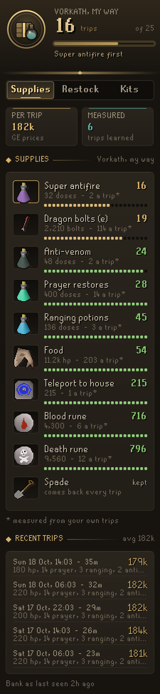
  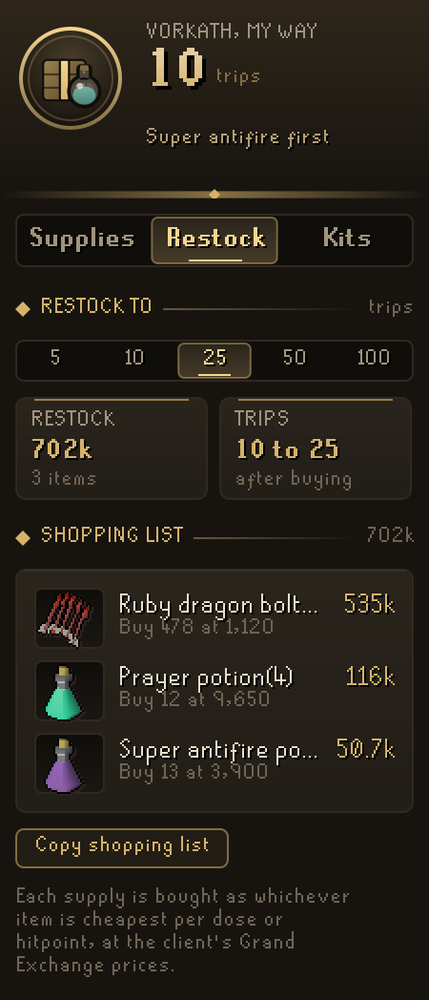
  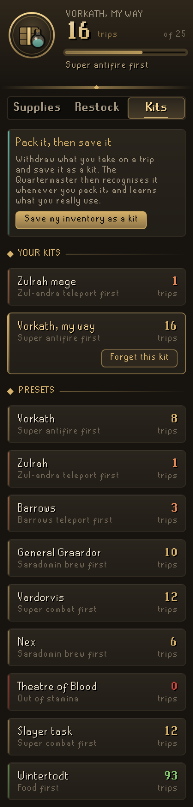
</p>

## What it does

- **Supplies.** The trips your bank supports for the chosen kit in large gilt figures, with a gauge against your restock target, and what runs out first. Every supply gets a row with what you hold, what a trip uses and how many trips that lasts, with a row of ration pips up to your restock target, so the short one stands out. Items that come back every trip (a spade, a rune pouch) are marked as kept and never count against you. Below that, what a trip costs at today's prices and your recent trips with how long they ran, what they used and what that cost.
- **Packing check.** At the bank, the Supplies page lists what the chosen kit still needs, each with the bank item to take and how many ("Prayer potion(4) x2, 8 doses short"), most urgent first, until it says "Packed for Vorkath". Doses kept only in potion storage are pointed out. While you are packing (the kit part-packed, or room in your inventory for the rest), the bank itself outlines those items in gold with a small count, and the marks go as the items come out; a visit to drop off a full inventory of loot is left unmarked. Pack most of a saved kit but leave the bank with a supply not packed at all, such as the spade for Barrows, and a line in the chat box says what you left behind. A preset never nags in the chat box, and once your trips show you never use one of its supplies (anti-venom in a serpentine helm), it stops asking for it.
- **How long the bank lasts.** Once two trips are measured, a tile turns the trips left into play time at your own pace: "4h 54m at 21m a trip".
- **Restock.** Pick a target of 5, 10, 25, 50 or 100 trips and get the shopping list: each supply bought as the item you already use most of, in its full form (anglerfish if you eat anglerfish, 4-dose divine ranging potions if that is what your bank holds, never cake slices or 1-dose potions), with quantities and the total bill. Copy the list to the clipboard for the Grand Exchange. Supplies the exchange does not sell are listed separately.
- **Pack to your trips.** After five trips with a kit you saved, the Supplies page says what to pack instead: what nine trips in ten really used, in whole items of what you carry ("Shark, 6 left over: 14 → 8"), or one more where a supply ran dry on two trips in ten (breaking the one teleport tablet you took to leave is not running dry). The header counts the inventory slots that frees, and **Pack these amounts** changes the saved kit. Presets and tools that come back are never tuned.
- **Restock every kit at once.** With two or more kits in use (your saved kits and the preset you chose), the Restock page can switch from **This kit** to **All kits**: one shopping list that stocks every kit for the target from the one bank they share. A trip there is one trip of each kit, so sharks two kits both eat are never counted as held twice.
- **What your trips earn.** Each measured trip also notes what came home that did not set out (drops, coins and the like, at today's prices), so after two trips the Supplies page shows the loot a trip and what the kit earns an hour once its supplies are paid for, every recent trip shows its own net, and each kit on the Kits page says what it earns: *Earns +1.8M an hour, +58k a trip*. Supplies, and the part-drunk potions and vials they turn into, are never counted as loot. Loot put in a looting bag is not seen, so a trip that fills one reads low.
- **Edit your kits.** Rename a saved kit from its card on the Kits page, and right-click any supply of a saved kit to set how much a trip takes (in hitpoints for food, doses for potions) or 0 for something that comes back every trip. Once you have kits of your own, the nine presets fold away to the one you use, a click from the rest.
- **Iron accounts.** Ironmen, hardcore, ultimate and group irons get the same page as a list of what to make or gather, most urgent first, instead of a Grand Exchange bill.
- **Kits.** Every kit at a glance with its trips and what runs out first. Nine presets ship with the plugin (Vorkath, Zulrah, Barrows, General Graardor, Vardorvis, Nex, Theatre of Blood, a slayer task and Wintertodt). Withdraw what you take on a trip and press **Save my inventory as a kit** to add your own; when you pack it again, the Quartermaster recognises it and switches to it. Coins are left out, a single tool such as a spade is marked as kept, and right-clicking a supply of a saved kit sets its amount or removes it from the kit.
- **Learning from your trips.** A trip runs from closing the bank to opening it again. What you set out with and what comes back are compared, supply by supply, and after two trips the plan uses your real averages instead of the kit's amounts. Deaths, quick bank shuffles and anything that changes while you are logged out are not counted.
- **Low supply warning.** When you set out with only a few trips left (three by default), a line in the chat box says which supply runs out and what restocking costs. It is said once, not again on every quick trip back into the bank.
- **Plaque.** A slim plaque in the game view with the trips left and what runs out first, shown at the bank, always, or never. Mid-pack at the bank it says what is still to withdraw instead.

<p align="center">
  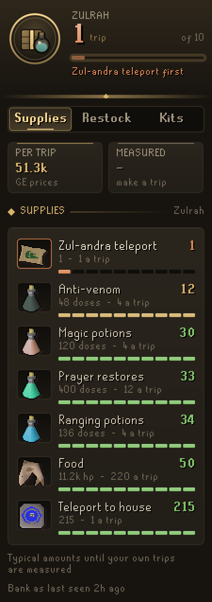
  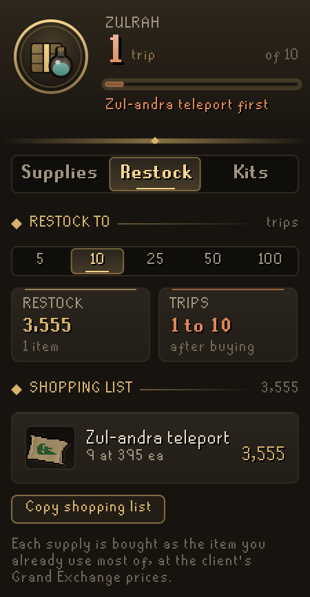
  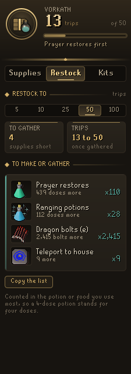
</p>
<p align="center">
  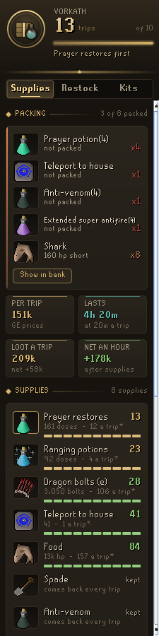
  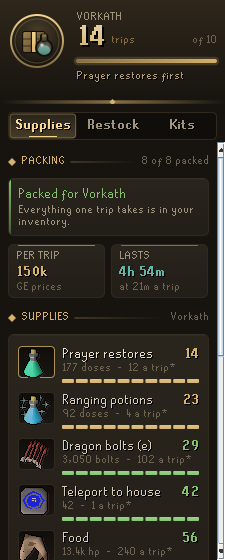
  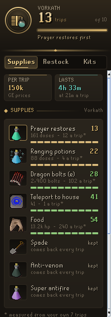
</p>
<p align="center">
  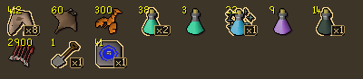
</p>
<p align="center">
  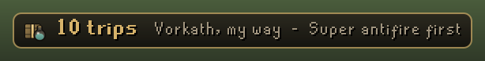
  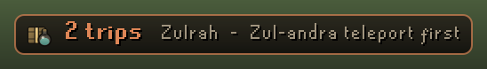
</p>

## How it counts

Supplies that stand in for one another are pooled. Food is counted in hitpoints healed, so a shark is 20 and a manta ray 22. Prayer potions, super restores and sanfew serums count as prayer doses; ranging, divine ranging, bastion and divine bastion potions as ranging doses; and so on for magic, super combat, antifire, anti-venom, stamina and Saradomin brews. Enchanted ruby and diamond dragon bolts count together. Anything else a saved kit carries is counted as its own item, including the runes in a rune pouch.

Your bank is read whenever it is open and remembered as last seen, so the panel works anywhere. If [Codex Bank Steward](https://github.com/Nubles/OSRS-Codex-Bank-Steward) saved your bank at a visit the Quartermaster missed (it was just installed, or turned off), that newer bank is counted instead, and the panel says whose it is until you open yours. The doses in the bank's potion storage are counted with it. What you carry (inventory, worn gear, rune pouch and the ammo in Dizana's quiver) is added to it. Prices are RuneLite's Grand Exchange prices. Everything is saved per account in your RuneLite profile.

Preset amounts are a typical trip of several kills, not a rule. They are only the starting point until your own trips are measured.

## For other plugins

Other plugins, Codex ones first, can read your kits without copying Quartermaster's tables. Each save also writes a stable, documented entry: RuneLite RS profile config, group `codexquartermaster`, key `kitsV1`, a JSON object:

```json
{
  "version": 1,
  "active": "kit:3",
  "target": 10,
  "kits": [
    {
      "id": "kit:3", "name": "Vorkath", "preset": false,
      "tripsLeft": 14, "limiting": "PRAYER",
      "needs": [
        { "supply": "FOOD", "name": "Food", "unit": "hp", "perTrip": 240, "measured": 181.5,
          "items": { "385": 20, "391": 22, "13441": 22 } },
        { "supply": "item:952", "name": "Spade", "perTrip": 0, "items": { "952": 1 } }
      ]
    }
  ]
}
```

- `active` is the kit you chose, saved or preset. It is left out when you have chosen none (a fresh install), even though the panel then shows the first preset. Saves from before this rule always named a kit, so a reader that must tell the two apart can also check the older `quarters` entry's `active`, which has only ever named a chosen kit.
- `kits` holds your saved kits first, then the presets (`preset: true`).
- `tripsLeft` is the trips the bank supports, or `-1` when nothing in the kit is used up or the bank has not been seen; `limiting` is the supply that runs out first, and is left out when `tripsLeft` is `-1`.
- Fields with no value are left out rather than written as `null`: `active` as above, `unit` for single-item supplies, `limiting` as above, and `measured` until it is known. Read a missing field as null.
- Each need's `items` maps every item id that counts toward it to its units each, so a pooled supply such as food or prayer resolves to concrete items. Ids are canonical, as the bank holds them. `perTrip` is the kit's own amount (`0` for a tool that comes back); `measured` is what trips really used on average, present once two trips are measured.
- The shape only grows. A breaking change would use a new key. The older internal `quarters` entry keeps its field names for plugins that already read it.

## Rules posture

Codex Quartermaster only reads what the game already shows you: your bank and its potion storage, inventory, worn gear, rune pouch and quiver, and RuneLite's own item prices. The bank outlines only draw over items; it does not click, withdraw, change menus, or send anything over the network.

## Development

```bash
./gradlew build   # compile and run tests
./gradlew run     # launch RuneLite with the plugin loaded
```

The planner and trip measuring (`core/`) are plain Java with unit tests; the panel and overlay are in `ui/` and `overlay/`.

## Licence

BSD 2-Clause, see [LICENSE](LICENSE).
